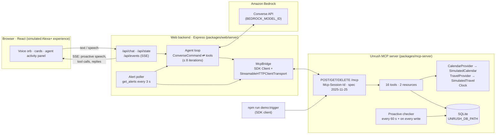

# Unrush

**An assistant that speaks first, before your evening falls apart.**

Unrush is a proactive household assistant presented as a **simulated Alexa+ experience**. It watches your calendar, your kitchen and your groceries. When a late meeting squeezes your evening, it tells you when to leave, swaps tonight's dinner for something that fits, notices the eggs are out and the milk is about to run out, and drafts the grocery order. Nothing is bought until you say yes.

Built for **Build, Ship, Shape: Amazon Developer Hackathon** (Alexa+ track + AWS Builder mini challenge).

- **Self-hosted MCP server:** spec **2025-11-25** over **Streamable HTTP**, built with the official TypeScript SDK `@modelcontextprotocol/sdk` **1.32.1**.
- **Amazon Bedrock:** the Converse API runs the agent loop and calls the MCP tools.
- TypeScript everywhere, Node 20+, npm workspaces, SQLite, Vitest. MIT licensed.

> **What is real and what is simulated?** See [Real vs simulated](#real-vs-simulated). In short, the MCP server, the Bedrock agent, the prediction logic and the memory are real. The calendar data, the travel times and the checkout are simulated and labelled **Simulated** in the UI.

---

## The hero flow

1. **A late meeting lands.** Your 5:30 Project sync now runs to 7:00, on an evening you planned to cook (`npm run demo:trigger`).
2. **Unrush speaks first:** *"Your 5:30pm Project sync now runs to 7pm. To reach your 7:30pm Study group you'll need to leave by 7:05pm."*
3. **The dinner swap.** Tonight's 45-minute chicken curry no longer fits; your longest free stretch is 40 minutes. Unrush offers a 15-minute tomato & garlic spaghetti made from what's in the pantry.
4. **Groceries.** Eggs are out (you said so this morning). Milk will run out tomorrow, predicted from six weeks of purchases.
5. **The order.** Unrush builds the order, reads it back and asks *"Shall I place the order?"* Nothing is bought without an explicit yes. On yes you get a **simulated** confirmation number and ETA.
6. **Memory.** Reload the page, start a new session or restart the server, and Unrush still remembers everything, because the state lives in the MCP server's SQLite database.

## Architecture



**How a proactive moment flows:**
1. `demo:trigger` (itself an MCP SDK client) calls `add_or_update_event`.
2. The MCP server's proactive checker runs immediately and writes `leave_by` and `meal_fit` alerts to SQLite.
3. The backend's poller claims them with `get_alerts {mark_delivered: true}`.
4. The poller runs the Bedrock agent with a *proactive instruction* ("speak first; explain, propose the fix, ask one yes/no question; don't act yet").
5. The agent calls MCP tools (`compute_leave_by`, `suggest_quick_meal`).
6. The backend streams every step to the browser over Server-Sent Events. The browser shows the banner, speaks the reply and fills the activity panel.

## MCP server

`packages/mcp-server` is the piece to read first. It is a self-hosted MCP server.

| | |
|---|---|
| Spec | **2025-11-25**. The negotiated version is logged at each session init and checked: `✓ session initialized {"requestedProtocol":"2025-11-25","negotiatedProtocol":"2025-11-25",…}` |
| Transport | **Streamable HTTP** at `/mcp`: `POST` (JSON-RPC), `GET` (SSE stream), `DELETE` (end session); `Mcp-Session-Id` session management; idle sessions reaped after 30 min; localhost DNS-rebinding protection via `createMcpExpressApp` |
| SDK | `@modelcontextprotocol/sdk` 1.32.1: `McpServer`, `registerTool`, `ResourceTemplate`, `StreamableHTTPServerTransport` on the server; `Client` and `StreamableHTTPClientTransport` in the web backend, the demo trigger and the tests |
| State | Everything is keyed by `household_id` and stored in SQLite (`UNRUSH_DB_PATH`, default `./data/unrush.db`). It survives sessions and restarts. |
| Logging | Every tool call is logged with its arguments and duration in ms; proactive alerts are logged when they fire |

**Tools.** Each tool has a zod input schema, a structured output schema and an LLM-oriented description.

| Area | Tool | What it does |
|---|---|---|
| Calendar | `get_schedule` | Events for a date (default today), with `leave_by` for events that need travel, plus `now` |
| | `add_or_update_event` | Create an event, or change one by id (the "late meeting") |
| | `compute_leave_by` | event start − travel (TravelProvider) − buffer; also the free minutes after the previous event, and any overlap |
| Pantry & meals | `get_pantry` / `update_pantry` | add / remove / set. "We're out of eggs" is `remove` with no quantity, which also records that the item ran out |
| | `get_preferences` / `set_preferences` | Diets, allergies, household size, usual and latest dinner time, leave buffer |
| | `get_meal_plan` / `save_meal_plan` | One dinner per date, with `prep_minutes` and ingredients. A swap by `recipe_id` keeps `previous_meal` |
| | `suggest_quick_meal` | Recipes ≤ `max_minutes` from a seeded library, filtered by diet and allergies, ranked by fewest missing pantry items |
| | `mark_meal_cooked` | Subtracts the dinner's ingredients from the pantry and logs the consumption. Idempotent |
| Groceries | `predict_runouts` | Per staple: predicted run-out date, confidence and a one-line reasoning, from purchase and usage history |
| | `build_grocery_order` | Missing meal ingredients + predicted run-outs + out-of-stock items, deduplicated and grouped by store section. Saved as a **draft** |
| | `place_order` | **Refuses unless `confirmed: true`.** Returns a simulated `SIM-XXXXXX` confirmation and ETA, and records the purchase so later predictions learn from it |
| | `get_order` | The latest order (or one by id), with its read-back |
| Proactive | `get_alerts` | Re-evaluates the rules and returns pending alerts. `mark_delivered` stops an alert from repeating |

**Resources:**
- `unrush://households/{id}/pantry`
- `unrush://households/{id}/schedule/today`

**Proactive checker.** The checker runs every 60 s and immediately after any calendar, pantry, plan or order write. Its rules:
- **(a) leave_by:** the departure is squeezed by the previous event (≤ 30 min of slack, or an overlap), or it is within 60 min.
- **(b) meal_fit:** tonight's dinner `prep_minutes` is longer than the longest free stretch. The stretch runs from `cook_window_start` to `latest_dinner_time`, minus events and travel.
- **(c) runout:** a staple is out, or is predicted to run out within 2 days.

Alerts are stored with dedupe keys and resolve themselves when the situation goes away (for example, the meeting moves back or the dinner is swapped).

**Run-out prediction.** For each staple bought at least 3 times:
- daily usage = (total bought − on hand) ÷ days since the first purchase
- days left = on hand ÷ daily usage
- confidence comes from the number of purchases and how regular the intervals were (coefficient of variation)

The reasoning string is meant to be read aloud, for example: *"Bought 11× in the last 6 weeks, about every 4 days (usually 2 l). Uses ~511 ml/day. 600 ml left → likely runs out tomorrow."*

**Providers.**
- `CalendarProvider`: the default is `SimulatedCalendar` (seeded events in SQLite).
- `TravelProvider`: the default is `SimulatedTravel` (fixed minutes per place, e.g. Library 20).
- `Clock`: real time, or `UNRUSH_NOW`.

A Google Calendar provider or a real maps API would implement the same interfaces. Both are on the roadmap and not built.

**Checking it with MCP Inspector:**

```bash
npm run dev
npx @modelcontextprotocol/inspector
# Transport: Streamable HTTP · URL: http://localhost:3001/mcp → Connect → Tools → get_alerts {household_id: "demo-household"}
```

## Where Amazon Bedrock is used

Bedrock is on the live code path for every conversation turn and every proactive moment. It is not optional decoration.

| File | What it does |
|---|---|
| [`packages/web/server/config.ts`](packages/web/server/config.ts) | Creates `BedrockRuntimeClient` from `@aws-sdk/client-bedrock-runtime` with `AWS_REGION`. Credentials come **only** from the default AWS credential chain |
| [`packages/web/server/mcpBridge.ts`](packages/web/server/mcpBridge.ts) | Converts the MCP `tools/list` result into a Converse `toolConfig` (`toolSpec.inputSchema.json`), hiding `household_id` from the model |
| [`packages/web/server/agent.ts`](packages/web/server/agent.ts) | Calls `ConverseCommand` with system prompt + history + tools. On `stopReason: "tool_use"` it runs each `toolUse` through MCP and sends back `toolResult` blocks (`json`, or `status: "error"`), repeating until `end_turn`. Capped at 8 model calls; `maxTokens` comes from `BEDROCK_MAX_TOKENS` |
| [`packages/web/server/app.ts`](packages/web/server/app.ts) | Runs the agent for chat turns (`POST /api/chat`) and for proactive turns (alert poller), streaming every step to the UI |
| [`packages/web/server/prompt.ts`](packages/web/server/prompt.ts) | Warm, brief voice persona anchored to the MCP server's clock: always use tools, short replies that can be spoken, never order without an explicit yes |

The model is never hard-coded: set `BEDROCK_MODEL_ID` to a model or inference profile enabled in your account. Tool use is required. **Amazon Nova Lite** (`us.amazon.nova-lite-v1:0`) is the recommended small, cheap default.

**Two locks on "nothing is bought without your yes":**
1. The MCP `place_order` tool refuses unless `confirmed === true`.
2. The backend blocks any `place_order {confirmed: true}` unless the assistant's previous turn asked about placing the order **and** the user's reply is an unambiguous yes ([`consent.ts`](packages/web/server/consent.ts)). Proactive turns can never place orders.

## Real vs simulated

| Piece | Status |
|---|---|
| MCP server, tools, Streamable HTTP sessions, SQLite memory | **Real** |
| Amazon Bedrock Converse agent loop with tool use | **Real** (needs your AWS account) |
| Leave-by math, free-time windows, quick-meal ranking, run-out prediction, order building | **Real** logic |
| Speech recognition and speech output | **Real** browser Web Speech APIs |
| Calendar events | **Simulated:** seeded demo data (`SimulatedCalendar`), labelled in the UI |
| Travel times | **Simulated:** fixed estimates per place (`SimulatedTravel`) |
| Grocery store, checkout, confirmation number, ETA | **Simulated:** no store is contacted and no money moves. The UI labels them "Simulated store" and "Simulated confirmation" |
| Six weeks of purchase history | **Simulated:** seeded so the prediction has data to learn from |
| "Offline rehearsal" mode (`npm run dev:offline`) | A **scripted stand-in, not Bedrock**, for rehearsing the UI without AWS. Its MCP calls are real. The UI shows an orange "Offline rehearsal (not Bedrock)" badge whenever it is on |

This is a **simulated Alexa+ experience** in a web browser. It is not an Alexa skill and does not use any Amazon device or Alexa service.

## Privacy

- **Data stays local.** All household state is in a SQLite file on your machine. The only data that leaves it is the conversation and tool results sent to Amazon Bedrock in your own AWS account.
- **Nothing is bought without explicit consent.** Two independent checks enforce this (see above). Checkout is simulated anyway.
- **No card data.** There are no payment fields or payment APIs anywhere, and nothing that stores card data. The simulated checkout only produces an order summary and a fake confirmation number.
- `.env` and `*.db` are gitignored. Credentials are never written by the app.

## Setup

**Prerequisites:** Node.js 20.6+ (developed on Node 24) and an AWS account.

1. **Enable a Bedrock model.** In the Amazon Bedrock console, pick your region (e.g. `us-east-1`), open **Model access** and enable a model that supports tool use. *Amazon Nova Lite* is cheap and fast. Many models must be called through a **cross-region inference profile** (IDs like `us.amazon.nova-lite-v1:0`); check **Cross-region inference** in the console for the exact ID available to you.
2. **Credentials** come from the default AWS credential chain: `aws configure`, `aws sso login`, `AWS_PROFILE`, environment variables or an IAM role. The identity needs `bedrock:InvokeModel` for that model or profile.
3. **Install and configure:**

```bash
git clone <this repo> && cd amazon-developer-hackathon
npm install
cp .env.example .env      # set AWS_REGION and BEDROCK_MODEL_ID; optionally UNRUSH_NOW=15:00
npm run seed              # create / reset the demo household
```

## Run

```bash
npm run dev               # MCP server :3001 + API :3000 + UI http://localhost:5173
npm run demo:trigger      # in another terminal: the late meeting lands → Unrush speaks first
npm run seed              # reset everything for another take
```

- `npm run chat` is a terminal REPL against Bedrock + MCP, useful to check your model before opening the UI.
- `npm run dev:offline` rehearses the UI without AWS, using the scripted stand-in (not Bedrock).
- **Recording tip:** the demo evening runs 5:30 to 9:30pm. If you record later in the day, set `UNRUSH_NOW=15:00` in `.env`, then reseed and restart, so the Unrush clock starts at 3pm and keeps ticking.
- **Voice:** hold the orb (or Space) to talk; Chrome has the best Web Speech support. Use the speaker toggle to mute spoken replies.

## Test

```bash
npm test          # 71 Vitest tests across both workspaces
npm run typecheck
```

What the tests cover:
- **Every tool:** leave-by math and overlaps, free-time windows, quick-meal ranking with diet and allergy filters, run-out prediction (dates, confidence, reasoning), order building and dedupe, and `place_order` refusing without confirmation.
- **Proactive rules,** dedupe and self-resolution.
- **MCP integration:** the real HTTP server driven by the SDK client, checking that the negotiated protocol is `2025-11-25`, the tool and resource listing, the hero flow with the agent scripted, reconnect, and a server restart.
- **Agent loop:** a fake Converse client against the real MCP server, including the order-consent gate and the 8-iteration cap.
- **Phase 3 end to end:** late meeting → SSE proactive speech → swap → read-back → explicit yes → simulated confirmation, plus the fallback that still speaks first when the model is unavailable.

## Cost

A full hero run is about 6–8 Converse calls of a few thousand input tokens each (mostly the 16 tool schemas). With Amazon Nova Lite that is a fraction of a cent per run; check current Bedrock pricing for your model and region. `BEDROCK_MAX_TOKENS` caps output per call, and token usage is shown per turn in the agent activity panel. Nothing else in the stack costs money.

## Project layout

```
packages/mcp-server   MCP server: transport, tools, proactive engine, providers, seed, demo trigger, tests
packages/web/server   Express backend: MCP client bridge, Bedrock agent loop, consent gate, SSE, CLI
packages/web/src      React UI: voice panel, cards, agent activity panel
DEMO_SCRIPT.md        2:45 video script
FRICTION_LOG.md       Friction hit with the MCP SDK, Streamable HTTP and Bedrock
FEEDBACK_NOTES.md     What worked well / what needs work
```

## Coming next

Out of scope for the hackathon build and not implemented:
- **Real integrations:** Google Calendar (`CalendarProvider`) and live travel times (`TravelProvider`), behind env flags
- **Fitness and workouts**
- **Body tracking**
- **Habit and goal coaching**
- **Restaurant suggestions** when there's no time to cook at all
- **Ride booking** when the leave-by time is too tight

## License

[MIT](LICENSE)
